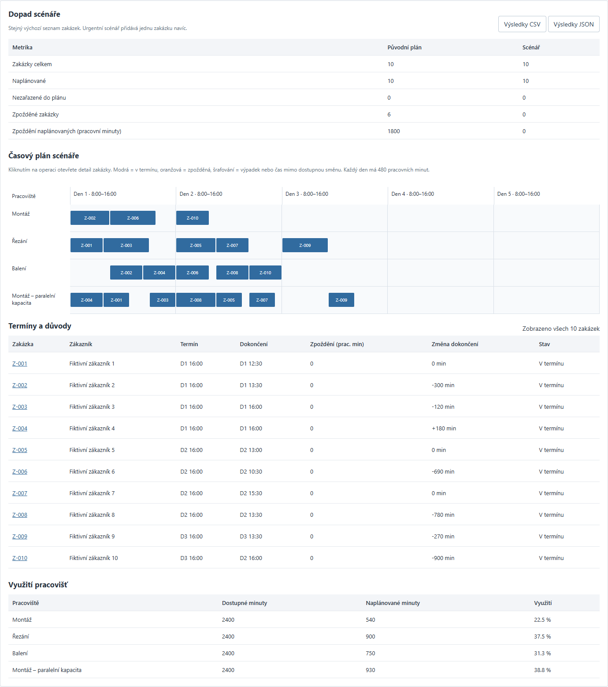

# PlanBoard

## Orientace v aplikaci (11. 11. 2026)

Při první návštěvě se otevře stručný návod. Po zavření si aplikace v tomto prohlížeči zapamatuje potvrzení; změna nemá vliv na obchodní data. V hlavičce lze kdykoli otevřít **Jak aplikaci používat** a **Technické informace**. Oba obsahy odkazují na úplný README zde na GitHubu. Pokud úložiště prohlížeče není dostupné, návod lze zavřít a aplikace dál funguje.

Operace se v rozhraní zobrazují česky: Řezání, Montáž a Balení. Strojové klíče cut/assembly/pack v JSON/CSV zůstávají stabilní kvůli kompatibilitě. Vlastní neznámé názvy se zobrazí tak, jak byly zadané.


**Plánování fiktivních zakázek, omezené kapacity a dopadu provozních změn.** Python plánovač sestaví časový plán, samostatně ověří jeho proveditelnost a porovná původní stav s výpadkem, urgentní zakázkou nebo paralelní kapacitou.



## Česky

### Co si vyzkoušet

1. Otevřete připravených deset zakázek. Upravte délku operace, požadovaný den nebo denní kapacitu a přepočítejte plán.
2. Vyberte výpadek prvního pracoviště, urgentní zakázku nebo paralelní kapacitu. Porovnání vychází ze stejného základního seznamu; urgentní scénář výslovně přidá jednu zakázku.
3. V časovém plánu otevřete operaci. Detail ukáže návaznost, nejdřívější vhodný interval kalendáře a další čekání po započtení obsazenosti a následujících směn.
4. Snižte kapacitu na 30 minut denně. Nezařazené zakázky zůstanou v tabulce s důvodem. Snížení součtu zpoždění tím, že se zakázka vynechá, se neprezentuje jako zlepšení.
5. Uložte scénář do SQLite nebo JSON, obnovte ho a znovu přepočítejte. CSV přenáší zakázky; JSON zachovává i kapacity a vybraný scénář. Výsledek porovnání lze stáhnout jako JSON nebo jako samostatné CSV všech zakázek, stavů, důvodů a změn dokončení.

### Co se skutečně počítá

- Pět pracovních dnů po 480 minutách. Minuta 0 znamená začátek první směny v 8:00; 480 konec první směny a začátek následujícího pracovního dne. Zobrazení rozlišuje konec a začátek směny. Noci a víkendy nejsou zahrnuté do pracovní doby ani metriky zpoždění.
- Zakázka má jednu nebo dvě navazující operace, typ požadovaného pracoviště, délku a termín na konci pracovního dne 1–5. Operace se nepřerušuje a nesmí přesáhnout směnu.
- Heuristika řadí celé zakázky podle priority, termínu a ID. U každé operace vybere nejbližší volný interval kompatibilního pracoviště. Nerozhoduje AI a výsledek není označený jako globálně optimální.
- Když nelze zařadit celou zakázku, žádná její rozpracovaná operace neblokuje ostatní. Nezařazení touto heuristikou není důkaz, že neexistuje jiné vhodné pořadí.
- Samostatný kontrolor ověřuje kalendář, výpadky, kompatibilitu, délky, návaznosti, překryvy, vysvětlení čekání a metriky. Využití se vztahuje ke skutečně dostupným minutám po odečtení sjednocených výpadků.

Ukázková data: základ má šest pozdních zakázek a součet zpoždění 1 800 pracovních minut. Dvouhodinový výpadek zvýší součet na 2 790; urgentní zakázka vede k sedmi pozdním zakázkám a 2 670 minutám. Paralelní kapacita odstraní zpoždění v tomto konkrétním příkladu. Vše vzniká běžícím výpočtem, ne připravenými výsledkovými kartami.

### Spuštění

Vyžaduje **Python 3.13+**, pouze standardní knihovnu:

```sh
python server.py
```

Otevřete http://127.0.0.1:4195. Není potřeba API klíč ani instalace Python balíčků. SQLite se vytvoří v ignorovaném `data/`. Historie má limit 100 uložených scénářů; položky lze v rozhraní odstranit.

### Import a výstupy

CSV v UTF-8, středník nebo čárka, přesně tyto sloupce:

```csv
id;customer;due_day;priority;op1_machine;op1_minutes;op2_machine;op2_minutes
Z-001;Fiktivní zákazník;1;0;cut;150;assembly;120
```

Typy ukázkových pracovišť: `cut` = řezání, `assembly` = montáž, `pack` = balení. Priorita je 0/1. Druhá operace může mít oba sloupce prázdné. Import mění zakázky a ponechává aktuální kapacity; celé prostředí přenáší JSON. Limit je 200 zakázek, 8 pracovišť, dvě operace, délka 1–480 minut a 128 kB na API požadavek/soubor. JSON má verzi; obnovení nikdy nepřebírá dříve vypočtený výsledek jako platný plán. CSV export předchází spuštění vzorců v tabulkovém procesoru; u takového textu přidá apostrof.

Výsledný CSV soubor má jiné schéma než vstupy: termín/dokončení v pracovních minutách, zpoždění, změnu dokončení, stav a důvod pro každou zakázku. Prázdné dokončení či zpoždění znamená nezařazenou zakázku; prázdná změna dokončení znamená novou nebo nezařazenou zakázku. Nula je skutečná nulová hodnota. Server export znovu vypočítá z validovaných vstupů.

### Testy

```sh
python -m unittest discover -s test -v
```

Browser QA vyžaduje Node.js 24 a vývojový Playwright:

```sh
pnpm install --frozen-lockfile
pnpm exec playwright install chromium
pnpm qa
```

Pokud příkaz `python` není na PATH, lze nastavit `PLANBOARD_PYTHON`. Pro místně nainstalovaný prohlížeč lze použít `PLAYWRIGHT_EXECUTABLE_PATH`. Testovací server používá oddělenou dočasnou databázi, nikoli běžnou historii uživatele. Důkazy a hranice ověření: [docs/QA.md](docs/QA.md).

### Architektura a možné zavedení

`planner.py` obsahuje validaci, plánovač a samostatný kontrolor. `storage.py` ukládá pouze verzované vstupy do SQLite s parametrizovanými dotazy. `imports.py` zpracovává CSV. `server.py` poskytuje omezené místní HTTP API a povolené statické soubory. `web/` obsahuje jednoduché rozhraní a časovou osu. Nejsou zde externí API, placený model, účty ani integrace s ERP/Asprovou.

Firemní pilot by začal odsouhlasením časových jednotek, směn, návazností, kapacit a vyhodnocovaných termínů. Potom by se známé zakázky ručně přepočítaly a srovnaly s nástrojem v odděleném prostředí. Skutečné zavedení vyžaduje přihlášení, oprávnění, správu kalendářů a zdrojových integrací, monitoring a provozní odpovědnost. Místní demo používá jen fiktivní data a nenahrazuje výrobní systém.

## English

First-time visitors see a keyboard-accessible guide; persistent header buttons reopen usage and technical information with a link to this README. Acknowledgement is browser-local and does not store business records. Operation labels are localized as Řezání (cut), Montáž (assembly), Balení (pack), while JSON/CSV machine keys remain stable. Custom names retain their supplied text.


PlanBoard is a local portfolio application for finite-capacity job planning. A deterministic Python heuristic schedules one or two nonpreemptive operations per job across compatible resources over five 480-minute workdays. It compares a shared baseline with a two-hour outage, an urgent job or parallel capacity, keeping unscheduled jobs visible. A separate checker verifies constraints, waiting explanations and metrics. It does not claim global optimality or use AI/API keys.

Users can edit orders and daily capacity, inspect a source-based timeline, import/export CSV jobs, save full input scenarios to JSON or local SQLite and recompute them after opening. Results export to JSON and a separate CSV summary including unscheduled jobs. Changes invalidate stale results; delayed planning, restore and reset responses cannot overwrite later edits. The stack is Python 3.13 standard library, SQLite and plain HTML/CSS/JavaScript. Node 24 and Playwright are development-only browser QA dependencies. Start with `python server.py` and visit http://127.0.0.1:4195.

The loopback-only server validates Host and write Origin, bounds JSON inputs, serves an allowlist of files and keeps runtime data out of Git. There is no production authentication, ERP integration, arbitrary optimization, material planning or real customer data. A company adoption would validate business rules and sample schedules first, then add identities, maintained source connections and operational controls.
